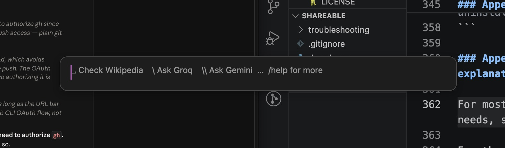

# DerpDerp



DerpDerp is a spotlight-like search tool for getting quick answers to simple queries. Press right ⌘ twice, ask a simple question with a clear answer, and get a quick response from Wikipedia, Tavily (the web), and/or an LLM.

This setup doc assumes you're a clueless vibe coder like me. It's pretty hand-holdy because I assume I'll need to reference it. 

Two things you should know:
- DerpDerp requires API keys to run. You must supply your own. I'll explain that later.
- DerpDerp requires MacOS. I built it for me, and I use MacOS. If you use Windows, ask Claude for help porting it.

---

## IN THIS DOC

```
DerpDerp/
├── .gitignore                    ← junk for git to ignore
├── LICENSE                       ← MIT — do as you wish
├── README.md                     ← setup guide (start here)
├── assets/                       ← the screenshot in this README
├── derpderp.py                   ← the whole tool
├── derpderp_config.example.py    ← your settings start here
└── troubleshooting/              ← for when it breaks
    ├── README.md                 ← what to do when stuck
    └── ask-llm-for-help.md       ← context to feed your LLM
```

**Part I — Do it**
- [1. Prerequisites](#1-prerequisites)
- [2. Get your keys](#2-get-your-keys)
- [3. How to download](#3-how-to-download)
- [4. Configure](#4-configure)
- [5. First run & permissions](#5-first-run--permissions)
- [6. See if it works](#6-see-if-it-works)
- [7. Using it day-to-day](#7-using-it-day-to-day)
- [8. Make it launch at login](#8-make-it-launch-at-login)
- [9. Tweaking DerpDerp](#9-tweaking-derpderp)

**Part II — Understand it**
- [10. What it is & what it's for](#10-what-it-is--what-its-for)
- [11. What's under the hood](#11-whats-under-the-hood)
- [12. The modifiers](#12-the-modifiers)
- [13. The quota readout](#13-the-quota-readout)

**Part III — Troubleshoot it**
- [Something broke? Ask a robot](#part-iii--troubleshoot-it)

**Reference**
- [A. Modifier grammar (full)](#appendix-a--modifier-grammar-full)
- [B. The LaunchAgent, explained](#appendix-b--the-launchagent-explained)
- [C. Errors with explanations](#appendix-c--errors-with-explanations)
- [D. A tour of the code](#appendix-d--a-tour-of-the-code)

---

## PART I — DO IT

Insert that one Shia LaBeouf meme here. Hehehe. God I'm old.

### 1. Prerequisites

To set up DerpDerp as I have done, and to love it as I love it, you will need:

- **macOS** → The script on this GitHub will only work on MacOS. This is because I use MacOS and I made this for myself. If you use Windows or Claude, download the `derpderp.py` file and the `ask-llm-for-help.md` file, give them to your LLM of choice, and then ask the LLM for help translating this to Windows/Linux. 
- **Python 3** (this is a python script) → 
   - To check if you have it → open `Terminal` then type `python3 --version` ; it should print `3.x`
   - If you don't have it → download the latest `3.x` build from [Python's website](python.org/downloads); or, if you use Brew, just type `brew install python` into your `Terminal`
- **The `pyobjc`** library** (which makes our GUI) → 
   - First, install Python 3
   - Then, open `Terminal` and type `pip3 install pyobjc-framework-Cocoa`
- **Your own damn API keys**, which we'll talk about in the next section

### 2. Get your keys

In theory, DerpDerp should do your derping with an API key from anywhere. Anywhere! In practice, you'll need to use the ones I used with it, unless, God forbid, you want to roll up your LLM's sleeves and figure out how to swap models yourself. 

| Provider | Required? | Get it at | Enables | Looks like |
|---|---|---|---|---|
| **Groq** | required | [console.groq.com](https://console.groq.com) | the default answer engine | `gsk_...` |
| **Tavily** | optional | [app.tavily.com](https://app.tavily.com) | Enables `s` web search functionality | `tvly-...` |
| **Gemini** | optional | [aistudio.google.com](https://aistudio.google.com) | Enables the `\\` Gemini engine | `AIza...` |

> ‼️ Groq shows your key **once** and then hides it forever, apparently for security reasons—so copy it into a notepad or something the moment you make it. (Tavily and Google let you view yours again later, but just grab all of them now; you'll need them for the next step.)

Wikipedia's MediaWiki Action API is open, free, and works out of the box. It's hard-coded into this script, so you don't need to worry about that one. 

**Tavily is free, but they employ a sort of dark pattern.** When you sign up and go through the onboarding flow, you'll be directed to an unclosable screen that asks you to input credit card information. To skip this, just close the tab, go back to their home page, and log in. You'll see that you have a free API key that caps out at 1,000 searches per month. 

### 3. How to download

You're probably reading this on the DerpDerp page on GitHub. To actually get the files onto your Mac:

1. Scroll up and click the green **`<> Code`** button. It's somewhere up or over there. (Gestures lazily.)
2. Click **Download ZIP**.
3. Find the `.zip` in your `Downloads` folder and double-click it to unzip.
4. Move the unzipped folder somewhere you'll remember. Anywhere is OK, but be relatively confident about it, because you'll have to redo some setup if you move it again.
5. Left-click the folder once, press `⌥⌘C` to copy its path to your clipboard, and then paste that somewhere. You'll need this later.

### 4. Configure

DerpDerp's settings live in their own file, so updating `derpderp.py` later never wipes them. In the DerpDerp folder, duplicate `derpderp_config.example.py` and name the copy `derpderp_config.py` (or, in `Terminal`: `cp derpderp_config.example.py derpderp_config.py`). Then right-click `derpderp_config.py` and open it with an editor of your choice. I use TextEdit.

At the top, you'll see the API keys:

🖥️
```python
GROQ_API_KEY   = ""
TAVILY_API_KEY = ""
GEMINI_API_KEY = ""
```

Take your API keys from the GET YOUR KEYS step and paste them right in the middle of those "quote marks". Leave a line blank if you don't have that key.

Below the API keys, you've got a few other options (the file explains each one):
- **Models** → Swap out the models DerpDerp uses
- **Limits** → The free-tier caps behind the quota readout under each answer (changing them changes the readout, not any real limit)
- **Hotkey** → Change the key you double-tap to open DerpDerp
- **Local files** → Where DerpDerp keeps its usage tally, its lock file, and your answer history
- **Panel** → How long a closed panel keeps your last answer
- **`%` lines** → Optional: hand a line to your own note or to-do script

> ‼️ **Read if you're a clueless vibe coder** <br> Git ignores `derpderp_config.py`, so if you fork this to a public repo, your keys stay on your Mac. Want them out of files altogether? Put `export GROQ_POPUPSEARCH="gsk_..."` (and `TAVILY_POPUPSEARCH`, `GEMINI_POPUPSEARCH`) in a hidden file called `~/.secrets`. DerpDerp reads those first, so the keys never live in the DerpDerp folder at all. That's how I run my own copy (so you nerds can't steal my free, limited-at-$0.00 keys).

### 5. First run & permissions

Now that all the manual tinkering is out of the way, press `cmd + space`, open `Terminal`, then input the folowing command: 

```bash
python3 derpderp.py
```

MacOS will ask for `Input Monitoring Permission`. DerpDerp needs this permission to open when you press your hotkey. 

To give DerpDerp these permissions: 

1. Open **System Settings → Privacy & Security → Input Monitoring**
2. Enable **Python** (add it if it's not listed)
3. Re-run `python3 derpderp.py`

... and nothing will happen. DerpDerp spends most of its life waiting quietly in the background. The search panel only opens when you **double-tap Right ⌘** (or whatever you've set your shortcut to).

### 6. See if it works

After opening DerpDerp, type `capital of france` or something and then hit `Enter`. After a brief delay, you should see `Paris` followed by an update about your Groq quota.

*(If nothing happens, don't panic — head to [Errors with explanations](#appendix-c--errors-with-explanations).)*

### 7. Using it day-to-day

- **Launch** → Open `Terminal`, `cd` into whatever folder you downloaded DerpDerp into, then type `python3 derpderp.py`
- **Open** → Double-tap Right ⌘ to open DerpDerp 
- **Add modifiers** → Preface your query with your desired modifiers (section 12), if necessary
- **Query** → Enter your short simple question and press return
- **Copy** → Press ⌘C (with nothing selected) to copy DerpDerp's whole answer to the clipboard, or click the **⧉** button in the top-right corner of the answer. Or press ⌘↩ instead of return: DerpDerp answers, copies the answer, and closes itself. With the box empty, ⌘↩ copies the answer on screen and closes.
- **Query again** → You can keep asking. While DerpDerp stays open it remembers the conversation, so follow-up questions build on the previous answer just fine. Close the panel and reopen it within 5 minutes, and your answer and the conversation are still there (`KEEP_ANSWER_MINUTES` in your settings file changes the 5). After that, its little derp brain is purged and the next session starts from scratch.
- **Ask it again** → Press ↑ in the box to bring back a question you asked earlier (↓ goes forward again).
- **Look back** → Type `/history` to see your last 10 questions and answers, even ones from earlier days.
- **Edit** → ⌘A, ⌘C, ⌘V and ⌘X work in the box like anywhere else.
- **Close** → Double-tap Right ⌘ while DerpDerp is open, or press Esc.

If you get it all set up and then forget what to do, just type `/help` to see how to format your queries.

### 8. Make it launch at login

If you follow the above instructions, you'll have to manually run the `derpderp.py` script each time you log into your computer to query your derps. 

Personally, I'd never remember to do that, and then I'd have to open terminal and remember what the script was and all that... which would entirely defeat the point of getting a quick answer to a dumb question!

Claude, bless him, helped a brother out. It turns out MacOS has this thing called a **LaunchAgent**, which is a thing that automatically runs scripts (or something) whenever you login. 

To set this up, open `Terminal` again and then just paste this bad boy below right in. It'll apparently figure out out where DerpDerp is located, tell that to your computer, and make you six inches taller. Or something. I don't actually know what it does. It's just what Claude told me you'd need to do to replicate this "always available" function yourself. 

```bash
PLIST="$HOME/Library/LaunchAgents/com.derpderp.agent.plist"
PY="$(command -v python3)"
SCRIPT="$HOME/path/to/derpderp.py"   # ⬅️ change to where you saved it
cat > "$PLIST" <<EOF
<?xml version="1.0" encoding="UTF-8"?>
<!DOCTYPE plist PUBLIC "-//Apple//DTD PLIST 1.0//EN" "http://www.apple.com/DTDs/PropertyList-1.0.dtd">
<plist version="1.0"><dict>
  <key>Label</key><string>com.derpderp.agent</string>
  <key>ProgramArguments</key><array><string>$PY</string><string>$SCRIPT</string></array>
  <key>RunAtLoad</key><true/>
  <key>KeepAlive</key><dict><key>SuccessfulExit</key><false/></dict>
  <key>ProcessType</key><string>Interactive</string>
  <key>StandardOutPath</key><string>$HOME/Library/Logs/derpderp.log</string>
  <key>StandardErrorPath</key><string>$HOME/Library/Logs/derpderp.log</string>
</dict></plist>
EOF
launchctl bootstrap gui/$(id -u) "$PLIST"
```

You won't see anything after running this command... but, if you go ahead and double-tap Right ⌘, DerpDerp should leap onto the screen in all its ~~glory~~ derpiness. And, from now on, it'll be there for you forever, even if you restart your computer from time to time. 

> ‼️ **IMPORTANT NOTE** <br> If you move DerpDerp to a new folder later on, you'll need to re-run the above script again. If you don't, it'll keep looking where DerpDerp _used_ to be, find nothing, and do nothing.

The script also holds a **single-instance lock**, so if it's ever started twice (agent + a manual run), the duplicate selflessly heroes itself instead of opening another instance that would eat a very, very small amount of RAM. More detail on that in [Appendix B](#appendix-b--the-launchagent-explained).

### 9. Tweaking DerpDerp

The LaunchAgent starts one long-running process from the file **at login**... and then it keeps _that_ version of DerpDerp on hand. That's usually exactly what you want—unless you don't, leading you to make edits to the .py script. 

... and you'll find that, unfortunately, no matter what edits you make, they aren't carried over.

For reasons beyond me, if you edit `derpderp.py`, you'll need to kick its sorry ass to the can and relaunch it for these changes to take effect. 

So, open `Terminal`, then paste this:
```bash
launchctl kickstart -k gui/$(id -u)/com.derpderp.agent
```
> ‼️ If you make an edit DerpDerp no longer opens, you probably goofed the python somehow. To figure out what went wrong, paste `tail ~/Library/Logs/derpderp.log` into Terminal and give that output to your LLM.

---

## PART II — UNDERSTAND IT

Now that you've got DerpDerp set up (hopefully), let's talk about how it works. 

### 10. What it is & what it's for

`DerpDerp` is just a Python script for getting quick answers to things you'd usually Google.

It works like this:
- Press right ⌘ twice, quickly
- A floating [NStext panel](https://en.wikipedia.org/wiki/Cocoa_text_system) will pop up en situ, on top of whatever else you have open
- Enter `\` followed by a space
- Type a simple question, like `when was milk tea invented` or `what's the html string to insert a blank space`
- Get a brief response, like `the 1980's` or `&nbsp;` 

Once you're done, double-press right ⌘ again to close DerpDerp.

> 🙋 I'm a tightass, and I assume you are, too. DerpDerp works by making API calls to Wikipedia and some small but free LLM models. It's for answering the sort of question that, upon hearing the answer, would make you smack your head and say "derp". It's not for answering questions that require any sort of analysis or consideration, or more than a few sentences to answer. 

### 11. What's under the hood

DerpDerp is an LLM wrapper. It answers your questions by giving an LLM (Groq/Gemini by default) two bits of context.

```
[ YOUR QUERY ]     → whatever you type in
   │
   ▼
[ SEARCH LAYER ]   → additional optional context
   │
   ▼
[ LLM LAYER ]      →  your answer, a few seconds later
```

The **search layer**, if invoked, appends additional context to your query to help the LLM respond.
- **[Wikipedia](https://en.wikipedia.org/w/api.php)** → A free, open API. DerpDerp calls it over `urllib` (idk what that is), opens the top 3 most-relevant entries, and fetches their introductions.
- **[Tavily](https://www.tavily.com/)** → A freemium API. You get 1,000 monthly queries for free. If invoked, Tavili will search for your query and (somehow) feed the answer into your LLM. I think. 
- **[Wiktionary](https://en.wiktionary.org/w/api.php)** → Also free and open. With the `w` flag, DerpDerp finds which words in your question have a Wiktionary entry and hands the LLM up to two of them (meanings, IPA, etymology). Wikipedia rarely has those for an ordinary word.

Whenever a search runs, the pages it used show up as clickable **Sources** links under the answer.

The **LLM layer** is where your query and any additional context is handed to an LLM.
- **[Groq](https://console.groq.com/)** → Connects you to small LLM models; if you're using DerpDerp for small, simple queries, as intended, you'll never hit its daily rate limit
- **[Gemini](https://aistudio.google.com/)** → Mostly here because my initial goal was to find a way to ping Gemini without yeeting it into godknowswhere in MacOS's desktop switcher, minimizing it, or hiding it. Terrible things happened when I used Gemini's builtin command to open a "mini chat". I don't know if it's Apple's fault or Google's, but it was horrible. Shudder for me. Anyway—Gemini only actually runs if you preface your query with `\\`, or on its own when Groq is still rate limiting after a retry.

You can preface your question with [modifiers](#12-the-modifiers) to mix and match these services. 

That's it. That's the whole tool. 

### 12. The modifiers

By default, DerpDerp directs your queries to Groq through Wikipedia because that's free, and I like free. In the event that you need a slightly more robust answer, you can modify Groq's behaviors by using some... modifiers. Oh, hell, this isn't a piece of creative writing, I'm not rewriting that to be more smooth. 

To do this:
- Enter a modifier from the below table
- Add a space
- Enter your query

| Type this | Engine | Web search |
|---|---|---|
| `your question` | Groq | Wikipedia (free) |
| `\your question` | Groq | none |
| `\\your question` | Gemini | none |

`\Groq` and `\\Gemini` can take additional tags to alter their functionality:
- `s` routes your query through Tavily to pull results from the live web
- `w` looks your word up on Wiktionary (meanings, IPA, etymology)
- `d` tells the LLM to provide the direct answer, and nothing but it, in plaintext, and copies it to your clipboard for you
- `c` copies the answer to your clipboard when it's done
- `p` sends whatever you've copied (⌘C) along with your question. Copy an error message, then type `\p what does this mean`

Here are some example queries for you:
- `what's the capital of peru` → no modifiers → DerpDerp searches Wikipedia to answer you
- `\s how much is bitcoin rn` → groq and search modifier → DerpDerp runs your query through Tavily so Groq can answer you
- `\\sd what's the html string to insert a zero-width space` → gemini, search, and direct modifiers → DerpDerp runs your query through Tavily, hands the answer to Gemini, and tells Gemini to answer you as directly as possible... hopefully in a way you can directly copy/paste into whatever you're working on
- `\wc french prendre ipa` → groq, Wiktionary, and copy modifiers → DerpDerp looks "prendre" up on Wiktionary, Groq answers, and the answer lands on your clipboard

These tags can be inserted in any order. `\\sd` and `\\ds` do the same thing.

> ‼️ **Tags only work glued to the backslash.** `\wc prendre ipa` works. `wc prendre ipa` (no backslash) is just a question, and DerpDerp asks Wikipedia about "wc prendre ipa". Yes, I did this myself. Leave a space between the tags and your question, too.

A line starting with `% ` never goes to an LLM. It hands the rest of the line to a command of your own (`PERCENT_COMMAND` in your settings file), like a note-taking or to-do script. It's off unless you set it.

You can also see this information by typing `/help` when DerpDerp first opens.

### 13. The quota readout

Appended to the end of each response is a single line telling you how many more searches you can do before needing to pay up. It'll look something like this:

```
— Groq 998/1000 req today · 7782 tok/min left
```
Included here you'll see mentioned: 
- **Groq** → These numbers are pulled directly from Groq's API and are exact. I love Groq.
- **Gemini** → You currently get 500 daily queries of `gemini-3.5-flash-lite` for free. Google's API doesn't reveal usage, so DerpDerp keeps track of how many times its Gemini instead. This counter resets daily. If (god forbid) you're worried you've hit your limit, visit [aistudio.google.com/usage](https://aistudio.google.com/usage)
- **Tavily** → You currently get 1,000 free web queries free per month. Tavily's API doesn't reveal usage, so DerpDerp keeps track of how many times it's called Tavily instead. This counter resets monthly. If you need to check how many queries you have left this month, visit [tavily.com/home](https://app.tavily.com/home).

DerpDerp adds a small .json file to your machine to tally up its calls to Gemini and Tavily. On my computer, and presumably also yours, that lives here: `~/.cache/derpderp_usage.json`. 

DerpDerp also saves every finished answer to `~/.cache/derpderp_history.txt` (that's what `/history` reads). To turn that off, set `HISTORY_FILE = ""` in your settings file.

---

## PART III — TROUBLESHOOT IT

Something broke, or you want to change how DerpDerp works? Head to the [`troubleshooting/`](troubleshooting/) folder. It's got a ready-made prompt and a technical rundown to hand your LLM, lol. Let the robot fix the robot.

---

## REFERENCE

### Appendix A — Modifier grammar (full)

A leading **backslash marks a command**; letters attached to it are **flags**.

- **0 backslashes** → Groq engine + Wikipedia context (the default).
- **1 backslash (`\`)** → Groq engine, no Wikipedia.
- **2 backslashes (`\\`)** → Gemini engine, no Wikipedia.
- **flag `s`** → add a Tavily live-web search.
- **flag `w`** → add a Wiktionary lookup.
- **flag `d`** → direct/raw output (bare answer, no formatting), copied to your clipboard.
- **flag `c`** → copy the answer to your clipboard when it's done.
- **flag `p`** → send your clipboard's text along with the question.

Flags come right after the backslash(es), before your question, in any order:

| Input | Engine | Search | Direct |
|---|---|---|---|
| `question` | Groq | Wikipedia | — |
| `\question` | Groq | none | — |
| `\\question` | Gemini | none | — |
| `\s question` | Groq | Tavily | — |
| `\d question` | Groq | none | ✅ |
| `\sd question` / `\ds question` | Groq | Tavily | ✅ |
| `\\s question` | Gemini | Tavily | — |
| `\\sd question` | Gemini | Tavily | ✅ |
| `\w question` | Groq | Wiktionary | — |
| `\ws question` | Groq | Wiktionary + Tavily | — |

Flags are read only right after a backslash, and only when every letter there is a flag: `\what is…` is just a question. With no backslash, the whole line is your question. A flag with nothing after it (`\p` alone) shows a hint and asks nothing. A line starting with `% ` goes to `PERCENT_COMMAND` instead of an LLM.

### Appendix B — The LaunchAgent, explained

A **LaunchAgent** is a small `.plist` file macOS reads to run something in your login session. The one in [step 8](#8-make-it-launch-at-login):

- `RunAtLoad` → start it at login.
- `KeepAlive { SuccessfulExit: false }` → restart it if it **crashes**, but not if it exits cleanly (so the single-instance duplicate can bow out without a restart loop).
- `StandardOutPath` / `StandardErrorPath` → send all output to `~/Library/Logs/derpderp.log`.

Useful commands:
```bash
launchctl kickstart -k gui/$(id -u)/com.derpderp.agent    # restart (after editing the script)
launchctl kill TERM gui/$(id -u)/com.derpderp.agent       # stop until next login
launchctl bootout gui/$(id -u) "$HOME/Library/LaunchAgents/com.derpderp.agent.plist"   # uninstall / disable
```

### Appendix C — Errors with explanations

For most of your troubleshooting needs, see [troubleshooting](#part-iii--troubleshoot-it).

For the few straightforward things I expect to go wrong, here's a cheatsheet:

| Symptom | Likely cause & fix |
|---|---|
| **Double-tap does nothing** | Input Monitoring not granted → System Settings → Privacy & Security → Input Monitoring → enable Python, then re-run/reload. |
| **`[HTTP 404] model … does not exist`** | Your account can't access `GROQ_MODEL`/`GEMINI_MODEL` → change it in your settings file (`derpderp_config.py`) to one your key has. |
| **`[HTTP 429]` / quota reached** | You hit a rate/day limit. Groq's per-minute token bucket refills in ~a minute (just wait a moment); Gemini's daily cap resets tomorrow. DerpDerp retries once. If Groq still says no and you have a Gemini key, Gemini answers instead (the panel tells you it switched). Without a Gemini key, wait it out. |
| **Panel stopped appearing after an edit** | Python error on launch → `tail ~/Library/Logs/derpderp.log` for the traceback. |
| **Answers seem doubled / hotkey acts twice** | Two instances running → the single-instance lock should prevent this; make sure you're not running it manually *and* via the LaunchAgent. |

### Appendix D — A tour of the code

It's one file, roughly in this order:

1. **SETTINGS block + `load_config`** — the built-in defaults, replaced by anything in your `derpderp_config.py`; then `load_secret` lets keys in your environment or `~/.secrets` win.
2. **`wiki_search` / `wiktionary_search` / `tavily_search` / `web_search`** — the search layer; each one also collects the Sources links shown under the answer.
3. **`stream` (Gemini) / `stream_openai` (Groq) / `llm_stream`** — the LLM layer; `llm_stream` picks the engine, and hands off to Gemini when Groq is rate limiting.
4. **`Controller` / `Panel`** — the macOS panel: building the UI, parsing modifiers in `submit()`, streaming text in, the copy button, the quota footer, Sources links, ↑ recall, the kept answer, `/history`, and `%` lines (`_run_percent`).
5. **`main()`** — acquires the single-instance lock and registers the global hotkey + the key monitors (Esc, ⌘C, ⌘↩, ⌘A/⌘V/⌘X).

To change behavior: the prompt lives in `SYSTEM`; the modifier parsing lives in `Controller.submit()`; the answer format for `\d` lives in `DIRECT_INSTRUCTION`. Your own settings go in `derpderp_config.py`, never in this file.
